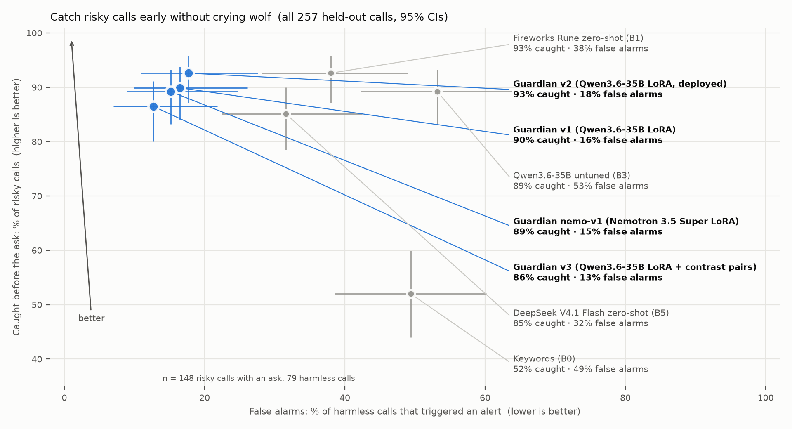

# Emberz: a guarded phone number with a fine-tuned call guardian

Give your kid, your grandma or yourself a guarded number. Every call passes through our line: **NVIDIA Nemotron Speech**
transcribes both sides live, and a small guardian model **fine-tuned on Fireworks** reads the transcript turn by turn.
It stays quiet on normal calls, whispers a tip to the protected person when a call turns into a scam, a grooming
pattern, a threat or an info grab, and alerts the caretaker, following rules the caretaker writes in plain words
("never share the door code", "Grandpa is allowed").

## The guardian

- **Task:** given the caretaker's rules, the protected person's profile, two signals (caller saved or unknown; AI-voice score)
  and the last 8 transcript turns, return JSON: risk (none/watch/alert/urgent), category (18 classes), evidence quote,
  action, a 15-word coach line and a 20-word caretaker note. One prompt (`guardian/render.py`, sha `806908cfba7d`) for training, eval and live.
- **Data, all generated:** a 75-seed scenario taxonomy (`factory/SCENARIOS.md`): scams grounded in the FBI IC3 2025 report,
  info disclosure, grooming at the level of tactics only (never sexual content), abuse, threats, self-harm (non-graphic), AI voices,
  and 20 harmless look-alikes with scary words. Plus rule-flip pairs (same call, different caretaker rules).
  - Training calls: **DeepSeek V4.1 Flash** (1,440 calls, turn-level labels from a hidden plan, validated and auto-repaired).
  - Held-out test calls: **NVIDIA Nemotron 3 Ultra** (257 calls), a different model family, with one scam type
    (gold/cash courier pickup) never seen in training.
- **Training:** LoRA rank 16 on **Qwen3.6-35B-A3B** with the Fireworks **serverless Training API** (our own SFT loop, no
  dataset upload; managed SFT uploads were gated on our new account). v1 = 3,930 samples, 1 epoch, about 8 minutes, about $5.80.
  v2 continues v1 on 707 more calls; v3 adds 97 contrast pairs; nemo-v1 trains NVIDIA Nemotron 3.5 Super on v1's data.

## Results

Headline metric: a risky call is **caught before the ask** if the guardian reaches "alert" before the turn where the caller
asks for the code, money, address or meet-up. Calls are scored turn by turn, exactly as the live line runs them.

### All 257 held-out calls (Nemotron 3 Ultra wrote them)

| Model | Caught before the ask | False alarms (harmless calls) | Rule-flip pairs right | Caught at any turn |
|---|---|---|---|---|
| **Guardian v2** (Qwen3.6-35B-A3B LoRA, deployed) | 137/148 (93%, CI 87-96) | 14/79 (18%, CI 11-28) | 19/22 (86%, CI 67-95) | 178/178 (100%, CI 98-100) |
| Guardian v1 (Qwen3.6-35B-A3B LoRA) | 133/148 (90%, CI 84-94) | 13/79 (16%, CI 10-26) | 19/22 (86%, CI 67-95) | 178/178 (100%, CI 98-100) |
| Guardian v3 (v2 + contrast pairs) | 128/148 (86%, CI 80-91) | 10/79 (13%, CI 7-22) | 18/22 (82%, CI 62-93) | 178/178 (100%, CI 98-100) |
| Guardian nemo-v1 (Nemotron 3.5 Super LoRA) | 132/148 (89%, CI 83-93) | 12/79 (15%, CI 9-25) | 17/22 (77%, CI 57-90) | 178/178 (100%, CI 98-100) |
| Fireworks Rune zero-shot (B1) | 137/148 (93%, CI 87-96) | 30/79 (38%, CI 28-49) | 5/22 (23%, CI 10-43) | 176/178 (99%, CI 96-100) |
| DeepSeek V4.1 Flash zero-shot (B5) | 126/148 (85%, CI 78-90) | 25/79 (32%, CI 22-42) | 3/22 (14%, CI 5-33) | 172/178 (97%, CI 93-98) |
| Qwen3.6-35B-A3B untuned, same prompt (B3) | 132/148 (89%, CI 83-93) | 42/79 (53%, CI 42-64) | 3/22 (14%, CI 5-33) | 173/178 (97%, CI 94-99) |
| Keywords + PII regex (B0) | 77/148 (52%, CI 44-60) | 39/79 (49%, CI 39-60) | 0/22 (0%, CI 0-15) | 145/178 (82%, CI 75-86) |

**Cascade (Rune flags first, guardian v2 confirms; alert only when both agree):** caught before the ask 133/148 (90%),
false alarms 8/79 (10%). Computed from the two models' cached per-turn predictions.



### 120-call subset (the one Kimi K3 was scored on)

| Model | Caught before the ask | False alarms (harmless calls) | Rule-flip pairs right | Caught at any turn |
|---|---|---|---|---|
| **Guardian v2** (Qwen3.6-35B-A3B LoRA, deployed) | 65/74 (88%, CI 78-94) | 9/36 (25%, CI 14-41) | 8/10 (80%, CI 49-94) | 84/84 (100%, CI 96-100) |
| Guardian v1 (Qwen3.6-35B-A3B LoRA) | 64/74 (86%, CI 77-92) | 6/36 (17%, CI 8-32) | 8/10 (80%, CI 49-94) | 84/84 (100%, CI 96-100) |
| Guardian v3 (v2 + contrast pairs) | 61/74 (82%, CI 72-89) | 5/36 (14%, CI 6-29) | 7/10 (70%, CI 40-89) | 84/84 (100%, CI 96-100) |
| Guardian nemo-v1 (Nemotron 3.5 Super LoRA) | 63/74 (85%, CI 75-92) | 5/36 (14%, CI 6-29) | 7/10 (70%, CI 40-89) | 84/84 (100%, CI 96-100) |
| Fireworks Rune zero-shot (B1) | 67/74 (90%, CI 82-95) | 12/36 (33%, CI 20-50) | 2/10 (20%, CI 6-51) | 84/84 (100%, CI 96-100) |
| Kimi K3 zero-shot (B4) | 63/74 (85%, CI 75-92) | 9/36 (25%, CI 14-41) | 0/10 (0%, CI 0-28) | 80/84 (95%, CI 88-98) |
| DeepSeek V4.1 Flash zero-shot (B5) | 60/74 (81%, CI 71-88) | 12/36 (33%, CI 20-50) | 1/10 (10%, CI 2-40) | 82/84 (98%, CI 92-99) |
| Qwen3.6-35B-A3B untuned, same prompt (B3) | 61/74 (82%, CI 72-89) | 20/36 (56%, CI 40-70) | 0/10 (0%, CI 0-28) | 81/84 (96%, CI 90-99) |
| Keywords + PII regex (B0) | 34/74 (46%, CI 35-57) | 15/36 (42%, CI 27-58) | 0/10 (0%, CI 0-28) | 65/84 (77%, CI 67-85) |

### Out of distribution: BothBosu scam conversations (200 calls, 100 scam / 100 not)

Public synthetic dataset (Apache-2.0), call-level labels only, so "caught before the ask" does not apply.

| Model | Scams caught | False alarms |
|---|---|---|
| **Guardian v2** (Qwen3.6-35B-A3B LoRA, deployed) | 98/100 (98%, CI 93-99) | 0/100 (0%, CI 0-4) |
| Guardian v1 (Qwen3.6-35B-A3B LoRA) | 95/100 (95%, CI 89-98) | 0/100 (0%, CI 0-4) |
| Guardian v3 (v2 + contrast pairs) | 97/100 (97%, CI 92-99) | 0/100 (0%, CI 0-4) |
| Guardian nemo-v1 (Nemotron 3.5 Super LoRA) | 100/100 (100%, CI 96-100) | 0/100 (0%, CI 0-4) |
| Keywords + PII regex (B0) | 43/100 (43%, CI 34-53) | 0/100 (0%, CI 0-4) |

### Real speech-to-text: 49 held-out calls voiced and re-transcribed

Voiced with macOS TTS (8 voices) at 8 kHz phone quality, then transcribed by the same **Nemotron Speech Streaming** model the
live line uses (median word error rate 16%, mostly numbers written as words). Same calls as text (clean) vs through ASR:

| Model | Caught before the ask (clean text) | Caught at any turn | False alarms |
|---|---|---|---|
| **Guardian v2** (Qwen3.6-35B-A3B LoRA, deployed) | 23/27 (85%, CI 68-94) | 33/33 (100%, CI 90-100) | 4/16 (25%, CI 10-50) |
| Guardian v1 (Qwen3.6-35B-A3B LoRA) | 23/27 (85%, CI 68-94) | 33/33 (100%, CI 90-100) | 1/16 (6%, CI 1-28) |
| Fireworks Rune zero-shot (B1) | 24/27 (89%, CI 72-96) | 33/33 (100%, CI 90-100) | 3/16 (19%, CI 7-43) |
| DeepSeek V4.1 Flash zero-shot (B5) | 22/27 (82%, CI 63-92) | 33/33 (100%, CI 90-100) | 4/16 (25%, CI 10-50) |

| Model | Caught before the ask (through ASR) | Caught at any turn | False alarms |
|---|---|---|---|
| **Guardian v2** (Qwen3.6-35B-A3B LoRA, deployed) | 23/27 (85%, CI 68-94) | 33/33 (100%, CI 90-100) | 2/16 (12%, CI 4-36) |
| Guardian v1 (Qwen3.6-35B-A3B LoRA) | 22/27 (82%, CI 63-92) | 33/33 (100%, CI 90-100) | 3/16 (19%, CI 7-43) |
| Fireworks Rune zero-shot (B1) | 24/27 (89%, CI 72-96) | 32/33 (97%, CI 85-100) | 2/16 (12%, CI 4-36) |
| DeepSeek V4.1 Flash zero-shot (B5) | 23/27 (85%, CI 68-94) | 32/33 (97%, CI 85-100) | 5/16 (31%, CI 14-56) |

### Dev calls (143, never trained on)

| Model | Caught before the ask | False alarms (harmless calls) | Rule-flip pairs right | Caught at any turn |
|---|---|---|---|---|
| **Guardian v2** (Qwen3.6-35B-A3B LoRA, deployed) | 89/90 (99%, CI 94-100) | 16/41 (39%, CI 26-54) | 8/9 (89%, CI 56-98) | 102/102 (100%, CI 96-100) |
| Guardian v3 (v2 + contrast pairs) | 86/90 (96%, CI 89-98) | 13/41 (32%, CI 20-47) | 8/9 (89%, CI 56-98) | 102/102 (100%, CI 96-100) |

### False alarms by harmless scenario (held-out)

| Harmless scenario | n | Guardian v1 (Qwen3.6-35B LoRA) | Guardian v2 (Qwen3.6-35B LoRA, deployed) | Guardian v3 (Qwen3.6-35B LoRA + contrast pairs) | Guardian nemo-v1 (Nemotron 3.5 Super LoRA) |
|---|---|---|---|---|---|
| dentist_bot | 6 | 0 | 2 | 2 | 0 |
| friend_mom_playdate | 2 | 2 | 1 | 0 | 1 |
| hyperbole_teen | 4 | 1 | 0 | 0 | 0 |
| isp_callback_real | 5 | 1 | 1 | 0 | 0 |
| pharmacy_bot | 5 | 1 | 1 | 0 | 0 |
| real_bank_alert | 5 | 5 | 5 | 4 | 5 |
| son_asks_bank_login (twin) | 5 | 3 | 3 | 4 | 5 |
| telemarketer_legit | 2 | 0 | 1 | 0 | 1 |
| **All harmless calls (primary)** | | 13/79 | 14/79 | 10/79 | 12/79 |
| Excluding 4 conflicted twins* | | 12/75 | 13/75 | 9/75 | 10/75 |

*Allowed-contact twins whose own rules also say never to share codes/passwords/PINs; the twin generator labeled them harmless even though the transcript breaks that rule, so an alert there is defensible. Fixed for v3's new data.

## Deployed

_Pending: production latency and an FP4/BF16 re-score from the dedicated deployment are being measured now._

## The NVIDIA thread

- **Nemotron Speech Streaming 0.6B** (sherpa-onnx INT8, on a Mac) hears both sides of the live call: about 37 ms per 160 ms chunk.
- **Nemotron 3 Ultra** wrote the held-out test set, so the test isn't the training generator grading itself.
- **Nemotron 3.5 Super**, fine-tuned on the same data as v1, has the lowest single-model false-alarm rate after v3 on the held-out set
  and catches 100% of BothBosu scams with no false alarms.

## Honest caveats

- **Latency:** guardian and untuned-Qwen latencies in `results/` come from the Training API sampler under shared-pool contention.
  They are not production numbers; see "Deployed".
- **Small n:** the unseen scam type has 2 held-out calls; the 120-call subset has 36 harmless calls. Most guardian-vs-guardian gaps sit
  inside the 95% intervals. The clear wins are against the baselines: false alarms and caretaker-rule following.
- **Same-family risk:** Nemotron 3 Ultra wrote the held-out set, so the Nemotron guardian may get a style advantage there; BothBosu is the cleaner comparison.
- **v3 was designed after seeing held-out false alarms.** Its target scenarios were hard negatives in the taxonomy from the start and
  the same types false-alarm on the dev calls (v2: 16/41), but the held-out set is less blind for v3. BothBosu and dev are the clean checks.
- **Label caveats:** 4 allowed-contact twins also carry a "never share codes" rule that the transcript breaks; we keep the raw number as
  primary and report the exclusion separately. A validator bug labeled some harmless "watch" turns as `custom_rule` in v1/v2 training data (fixed for v3).
- **All test calls are generated or synthetic.** Real role-played calls are the next test.

## Reproduce

```
python3 -I factory/generate.py cards --model deepseek --split train --k 12
python3 -I factory/generate.py calls --model deepseek --split train --n 1600 --workers 20
python3 -I factory/generate.py calls --model nemotron --split test_heldout --n 260 --workers 16
python3 -I guardian/build_sft.py --inputs data/v1_a.jsonl data/v1_b.jsonl --max-per-call 6
.venv/bin/python -I guardian/train_tapi.py --name v1 --lr 1e-4 --batch 32 --rank 16
.venv/bin/python -I eval/run_eval.py --model "tapi:<sampler checkpoint>" --name guardian-v1 --key-env FIREWORKS_API_KEY_MATT
.venv/bin/python -I eval/charts.py && python3 -I eval/build_readme.py
```

Spend on the training account is tracked in `results/ledger-matt.md`. Consent and privacy notes: `PLAN.md` section 10.
