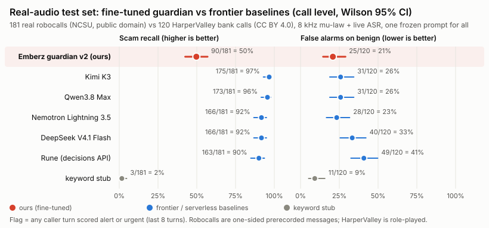

# Real-audio test set (realset): frontier baselines

**111 real calls** (61 scam robocalls, 50 benign bank calls), 76 min of audio, 503 scored caller turns. Every call went through our phone path and live ASR; every model saw identical transcripts.

## Results (call level)

| Model | Scam recall | 95% CI | False alarms on benign | 95% CI | Turn errors | Cost (USD) | p50 latency |
|---|---|---|---|---|---|---|---|
| qwen3p8-max | 57/61 = **93%** | 84%-97% | 9/50 = **18%** | 10%-31% | 0/503 (33 JSON-mode retries) | 1.41 | 2946 ms |
| kimi-k3 | 58/61 = **95%** | 87%-98% | 10/50 = **20%** | 11%-33% | 0/503 (0 JSON-mode retries) | 1.31 | 2152 ms |
| keyword-stub | 1/61 = **2%** | 0%-9% | 4/50 = **8%** | 3%-19% | 0/503 (0 JSON-mode retries) | 0.00 | - ms |

Recall by scam type:

| Model | amazon_apple_order | auto_warranty | bank_credit_card | delivery_parcel | gov_ssa_irs | prize_travel_health | tech_support_utility |
|---|---|---|---|---|---|---|---|
| qwen3p8-max | 11/11 | 5/6 | 10/10 | 3/3 | 14/14 | 6/7 | 8/10 |
| kimi-k3 | 11/11 | 6/6 | 10/10 | 3/3 | 14/14 | 6/7 | 8/10 |
| keyword-stub | 0/11 | 0/6 | 1/10 | 0/3 | 0/14 | 0/7 | 0/10 |

## Method

- **Scam (61):** NCSU Robocall Audio Dataset (FTC Project Point of No Entry; data public domain, https://github.com/wspr-ncsu/robocall-audio-dataset). English, transcript >= 25 words, near-duplicate campaigns removed, seeded (20261102) stratified pick by a keyword scam type read from the dataset's Whisper transcript, one per carrier case first. Types: amazon_apple_order 11, auto_warranty 6, bank_credit_card 10, delivery_parcel 3, gov_ssa_irs 14, prize_travel_health 7, tech_support_utility 10.
- **Benign (50):** HarperValleyBank (Gridspace-Stanford, CC BY 4.0, https://github.com/cricketclub/gridspace-stanford-harper-valley). Real human speakers role-playing bank customer-service calls with account, card, PIN/password and transfer talk (hard negatives). Seeded pick from a 220-call random sample, round-robin over task types, calls >= 25 s. Tasks: check_balance 7, get_branch_hours 7, order_checks 6, pay_bill 6, replace_card 6, reset_password 6, schedule_appointment 6, transfer_money 6.
- **Phone path + ASR:** each channel resampled to 8 kHz, G.711 mu-law (`line/audio.py`), fed in 20 ms frames into `line.asr.CallTranscriber` (Nemotron Speech Streaming 0.6B int8 via sherpa-onnx, the live line's code and endpointing). Robocalls: the recording is the caller track; the protected track is not fed (it would be digital silence). HarperValley: agent channel = caller, customer channel = protected.
- **Guardian input:** Matt's frozen prompt `guardian/render.py` (PROMPT_SHA 806908cfba7d). One request at the end of every caller turn with the last 8 turns; profile `elder` for all calls (so the profile can't leak the class), no rules, unknown number, voice unknown, no 'earlier' verdict. Temperature 0, max_tokens 600, reasoning_effort none.
- **JSON:** no response_format on the first attempt (same as Matt's sampler). A reply with no parseable JSON is retried once with `response_format: json_object`; both attempts are counted in cost.
- **Decision:** a call is flagged if any scored turn has risk alert or urgent. Wilson 95% intervals. Failed or unparseable replies count as not flagged.
- **Reproduce:** `python -m realset.select_calls` (manifest), fetch audio from the URLs in `realset/manifest.csv`, `python -m realset.transcribe`, `python -m realset.score --model <id> --tag <tag>`, `python -m realset.metrics`.

## Caveats

- **Robocalls are one-sided prerecorded messages** (often TTS), not conversations. They test whether a model recognizes a real scam pitch through real ASR errors; they do not test catching the ask mid-conversation, and there is no victim side.
- **HarperValley is role-played** from task templates by paid speakers (real voices, scripted scenario, small vocabulary), so it is an easy benign set in content even though it is full of account and card talk. Real unscripted benign calls (CallHome/CallFriend) are not in this set.
- The two classes come from different sources, so a model could separate them by style (monologue vs dialogue). Read this as a sanity check on real audio, not as the headline benchmark.
- Scam type is a keyword bucket over the dataset's Whisper transcript, not a human label; labels are source-level (every NCSU call is treated as scam, the FTC letters name them as illegal robocall campaigns).
- The ASR is our live Nemotron path on simulated (offline) G.711, not a real PSTN leg.

- qwen3p8-max: missed scams ncsu_63405, ncsu_28342, ncsu_1348032, ncsu_447375; false alarms hv_a81d06d3ad99495d, hv_a999d956e52c4635, hv_e2c66a7bd76e45fd, hv_bb9fda54a22344cd, hv_ec4eae85cdb946e0, hv_79fd27e709544567, hv_d96b4057a7c249d3, hv_f668f0034b4f4e97, hv_a554d05175f64f1f.
- kimi-k3: missed scams ncsu_547611, ncsu_1348032, ncsu_447375; false alarms hv_5c761521b3004564, hv_7ca9c78c16874c15, hv_a81d06d3ad99495d, hv_f596326a596a4bcc, hv_298caa495dd144c0, hv_c15574c69e6c4c33, hv_d96b4057a7c249d3, hv_f668f0034b4f4e97, hv_a554d05175f64f1f, hv_4822ffb6a74b4927.
- keyword-stub: missed scams ncsu_807762, ncsu_387225, ncsu_544702, ncsu_500579, ncsu_516512, ncsu_694463, ncsu_630197, ncsu_55580, ncsu_1631035650.66108_in_AKA_Management_Robocall__Computer-Hijack, ncsu_373798, ncsu_761222, ncsu_70642; false alarms hv_6913f7cf2f2144a7, hv_d89ea95f9592404c, hv_f596326a596a4bcc, hv_79fd27e709544567.
