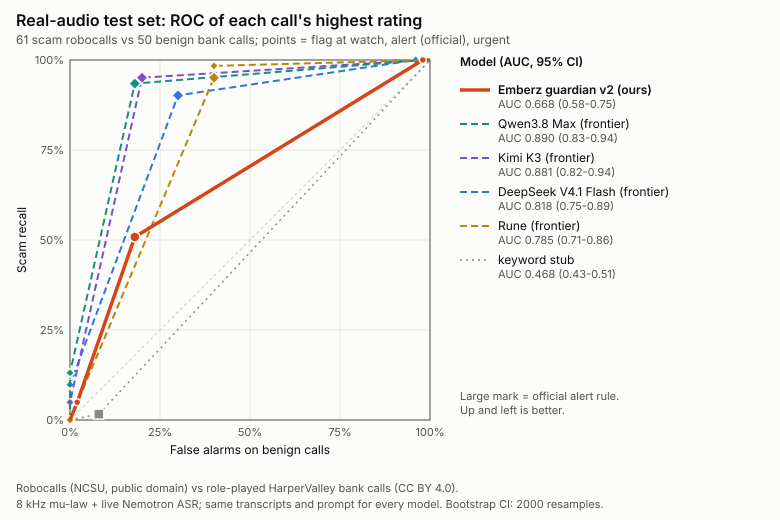

# Realset: extended metrics

111 real calls (61 scam robocalls, 50 benign bank calls), 76 min of audio, 503 caller turns. Same transcripts, same prompt, every model. Built by `python -m realset.metrics_plus` from `data/realset/scores/*.jsonl`; full numbers in `data/realset/metrics_plus.json`. Official rule: a call is flagged if any caller turn is rated alert or urgent.

## 1. Official rule, all calls

| Model | Scam recall (95% CI) | False alarms (95% CI) | Precision | F1 | Balanced acc. | AUC of max risk (95% CI) |
|---|---|---|---|---|---|---|
| Emberz guardian v2 (ours) | 31/61 = **51%** (39-63%) | 9/50 = **18%** (10-31%) | 78% | 0.61 | 66% | 0.67 (0.58-0.75) |
| Qwen3.8 Max | 57/61 = **93%** (84-97%) | 9/50 = **18%** (10-31%) | 86% | 0.90 | 88% | 0.89 (0.83-0.94) |
| Kimi K3 | 58/61 = **95%** (87-98%) | 10/50 = **20%** (11-33%) | 85% | 0.90 | 88% | 0.88 (0.82-0.94) |
| DeepSeek V4.1 Flash | 55/61 = **90%** (80-95%) | 15/50 = **30%** (19-44%) | 79% | 0.84 | 80% | 0.82 (0.75-0.89) |
| Rune | 58/61 = **95%** (87-98%) | 20/50 = **40%** (28-54%) | 74% | 0.83 | 78% | 0.79 (0.71-0.86) |
| Nemotron Lightning 3.5 (partial: 9/111 calls) | 7/7 = **100%** (65-100%) | 1/2 = **50%** (9-91%) | 88% | 0.93 | 75% | 0.79 (0.50-1.00) |
| keyword stub | 1/61 = **2%** (0-9%) | 4/50 = **8%** (3-19%) | 20% | 0.03 | 47% | 0.47 (0.43-0.51) |

AUC treats the call's highest rating (none < watch < alert < urgent) as a 4-level score: 0.5 is chance, 1.0 is perfect separation. CI: stratified bootstrap, 2000 resamples, seed 20261102.

## 2. Three operating points

Flag the call if its highest rating reaches watch, alert (official) or urgent.

| Model | >= watch: recall / false alarms | >= alert: recall / false alarms | >= urgent: recall / false alarms |
|---|---|---|---|
| Emberz guardian v2 (ours) | 100% / 98% | 51% / 18% | 5% / 2% |
| Qwen3.8 Max | 100% / 98% | 93% / 18% | 13% / 0% |
| Kimi K3 | 100% / 98% | 95% / 20% | 5% / 0% |
| DeepSeek V4.1 Flash | 100% / 96% | 90% / 30% | 10% / 0% |
| Rune | 98% / 40% | 95% / 40% | 0% / 0% |
| Nemotron Lightning 3.5 (partial: 9/111 calls) | 100% / 50% | 100% / 50% | 14% / 0% |
| keyword stub | 2% / 8% | 2% / 8% | 0% / 0% |

Highest rating per call (scam calls / benign calls, counts of none, watch, alert, urgent):

- Emberz guardian v2 (ours): scam [0, 30, 28, 3], benign [1, 40, 8, 1]
- Qwen3.8 Max: scam [0, 4, 49, 8], benign [1, 40, 9, 0]
- Kimi K3: scam [0, 3, 55, 3], benign [1, 39, 10, 0]
- DeepSeek V4.1 Flash: scam [0, 6, 49, 6], benign [2, 33, 15, 0]
- Rune: scam [1, 2, 58, 0], benign [30, 0, 20, 0]
- Nemotron Lightning 3.5 (partial: 9/111 calls): scam [0, 0, 6, 1], benign [1, 0, 1, 0]
- keyword stub: scam [60, 0, 1, 0], benign [46, 0, 4, 0]

## 3. How early the alert comes (scam calls the model flagged, official rule)

Median (IQR). Seconds = end of the flagged caller turn, when the request is sent; add the model latency for when the alert would show. Words heard = share of the call's caller words spoken by then (lower = earlier).

| Model | Flagged scams | Seconds into call | Seconds incl. model latency | Caller turn # | Words heard | Flagged on 1st caller turn |
|---|---|---|---|---|---|---|
| Emberz guardian v2 (ours) | 31 | 14.6 (11.4-17.3) | 16.1 (12.6-18.5) | 1 (1-2) | 0.77 (0.61-0.96) | 19/31 |
| Qwen3.8 Max | 57 | 14.4 (10.3-14.9) | 16.0 (13.8-19.5) | 1 (1-1) | 0.71 (0.54-0.96) | 46/57 |
| Kimi K3 | 58 | 14.4 (10.3-15.0) | 17.1 (12.7-18.8) | 1 (1-1) | 0.72 (0.55-0.96) | 45/58 |
| DeepSeek V4.1 Flash | 55 | 14.6 (12.4-15.6) | 16.1 (13.8-17.0) | 1 (1-2) | 0.78 (0.61-1.00) | 35/55 |
| Rune | 58 | 14.3 (10.2-14.9) | 14.4 (10.3-15.0) | 1 (1-1) | 0.70 (0.48-0.94) | 48/58 |
| Nemotron Lightning 3.5 (partial: 9/111 calls) | 7 | 13.6 (10.4-14.3) | 14.0 (11.3-14.7) | 1 (1-2) | 0.61 (0.52-0.74) | 5/7 |
| keyword stub | 1 | 8.5 (8.5-8.5) | 8.5 (8.5-8.5) | 1 (1-1) | 1.00 (1.00-1.00) | 1/1 |

Same 31 scams for every model (the ones all 5 full-coverage LLM guardians flagged), so the times compare like for like:

| Model | Seconds into call | Caller turn # | Words heard |
|---|---|---|---|
| Emberz guardian v2 (ours) | 14.6 (11.4-17.3) | 1 (1-2) | 0.77 (0.61-0.96) |
| DeepSeek V4.1 Flash | 14.6 (11.4-15.4) | 1 (1-2) | 0.71 (0.58-0.95) |
| Kimi K3 | 14.5 (9.4-15.1) | 1 (1-1) | 0.68 (0.55-0.94) |
| Qwen3.8 Max | 14.3 (8.8-14.9) | 1 (1-1) | 0.67 (0.50-0.93) |
| Rune | 14.3 (8.4-14.8) | 1 (1-1) | 0.62 (0.36-0.88) |

Scam robocalls are short (median 2 caller turn(s)), so these times mostly measure how much of a monologue the model needs before it is sure, not how early it would catch a live conversation.

## 4. Paired comparison (same calls, official rule)

Difference = row model minus column model. McNemar exact test on per-call right/wrong; paired bootstrap 95% CI of the difference.

| A vs B | Calls | Recall A-B (95% CI) | McNemar p (scams) | False alarms A-B (95% CI) | McNemar p (benign) |
|---|---|---|---|---|---|
| Emberz guardian v2 (ours) vs DeepSeek V4.1 Flash | 111 | -39 pts (-51 to -28) | <0.001 (0:24) | -12 pts (-22 to -4) | 0.031 (6:0) |
| Emberz guardian v2 (ours) vs Kimi K3 | 111 | -44 pts (-57 to -31) | <0.001 (0:27) | -2 pts (-14 to +10) | 1.000 (5:4) |
| Emberz guardian v2 (ours) vs Qwen3.8 Max | 111 | -43 pts (-56 to -30) | <0.001 (0:26) | +0 pts (-12 to +10) | 1.000 (4:4) |
| Emberz guardian v2 (ours) vs Rune | 111 | -44 pts (-57 to -31) | <0.001 (0:27) | -22 pts (-34 to -12) | 0.001 (11:0) |
| Emberz guardian v2 (ours) vs keyword stub | 111 | +49 pts (+36 to +62) | <0.001 (30:0) | +10 pts (+0 to +20) | 0.125 (1:6) |
| DeepSeek V4.1 Flash vs Kimi K3 | 111 | -5 pts (-11 to +0) | 0.250 (0:3) | +10 pts (+0 to +20) | 0.180 (2:7) |
| DeepSeek V4.1 Flash vs Qwen3.8 Max | 111 | -3 pts (-8 to +0) | 0.500 (0:2) | +12 pts (+0 to +24) | 0.109 (2:8) |
| DeepSeek V4.1 Flash vs Rune | 111 | -5 pts (-13 to +2) | 0.375 (1:4) | -10 pts (-18 to -2) | 0.062 (5:0) |
| DeepSeek V4.1 Flash vs keyword stub | 111 | +89 pts (+80 to +97) | <0.001 (54:0) | +22 pts (+10 to +34) | 0.001 (0:11) |
| Kimi K3 vs Qwen3.8 Max | 111 | +2 pts (-3 to +8) | 1.000 (2:1) | +2 pts (-10 to +14) | 1.000 (5:6) |
| Kimi K3 vs Rune | 111 | +0 pts (-5 to +5) | 1.000 (1:1) | -20 pts (-30 to -10) | 0.002 (10:0) |
| Kimi K3 vs keyword stub | 111 | +93 pts (+87 to +98) | <0.001 (57:0) | +12 pts (+0 to +24) | 0.146 (3:9) |
| Qwen3.8 Max vs Rune | 111 | -2 pts (-8 to +3) | 1.000 (1:2) | -22 pts (-36 to -10) | 0.003 (12:1) |
| Qwen3.8 Max vs keyword stub | 111 | +92 pts (+84 to +98) | <0.001 (56:0) | +10 pts (-2 to +24) | 0.227 (3:8) |
| Rune vs keyword stub | 111 | +93 pts (+87 to +98) | <0.001 (57:0) | +32 pts (+20 to +46) | <0.001 (0:16) |

(x:y) = calls only A got right : calls only B got right. No correction for multiple comparisons.

## 5. Where models win and lose

Scam recall by type:

| Model | amazon_apple_order | auto_warranty | bank_credit_card | delivery_parcel | gov_ssa_irs | prize_travel_health | tech_support_utility |
|---|---|---|---|---|---|---|---|
| Emberz guardian v2 (ours) | 10/11 | 0/6 | 5/9 | 0/3 | 12/12 | 0/6 | 4/14 |
| Qwen3.8 Max | 11/11 | 5/6 | 9/9 | 3/3 | 12/12 | 5/6 | 12/14 |
| Kimi K3 | 11/11 | 6/6 | 9/9 | 3/3 | 12/12 | 5/6 | 12/14 |
| DeepSeek V4.1 Flash | 11/11 | 4/6 | 9/9 | 3/3 | 12/12 | 5/6 | 11/14 |
| Rune | 11/11 | 6/6 | 9/9 | 3/3 | 12/12 | 5/6 | 12/14 |
| Nemotron Lightning 3.5 (partial: 9/111 calls) | 2/2 | - | - | - | 1/1 | 3/3 | 1/1 |
| keyword stub | 0/11 | 0/6 | 1/9 | 0/3 | 0/12 | 0/6 | 0/14 |

False alarms by HarperValley task:

| Model | check_balance | get_branch_hours | order_checks | pay_bill | replace_card | reset_password | schedule_appointment | transfer_money |
|---|---|---|---|---|---|---|---|---|
| Emberz guardian v2 (ours) | 0/7 | 0/7 | 1/6 | 5/6 | 0/6 | 3/6 | 0/6 | 0/6 |
| Qwen3.8 Max | 0/7 | 0/7 | 1/6 | 4/6 | 0/6 | 2/6 | 0/6 | 2/6 |
| Kimi K3 | 0/7 | 0/7 | 5/6 | 2/6 | 0/6 | 3/6 | 0/6 | 0/6 |
| DeepSeek V4.1 Flash | 0/7 | 0/7 | 4/6 | 6/6 | 0/6 | 4/6 | 0/6 | 1/6 |
| Rune | 0/7 | 0/7 | 6/6 | 6/6 | 0/6 | 4/6 | 0/6 | 4/6 |
| Nemotron Lightning 3.5 (partial: 9/111 calls) | - | - | - | - | 1/1 | 0/1 | - | - |
| keyword stub | 0/7 | 0/7 | 1/6 | 3/6 | 0/6 | 0/6 | 0/6 | 0/6 |

Category of the first alert on each false-alarm call:

- Emberz guardian v2 (ours): disclosure.financial_id 4, disclosure.credentials_otp 4, disclosure.location_school 1
- Qwen3.8 Max: disclosure.location_school 4, scam.impersonation_bank_gov 4, scam.tech_support 1
- Kimi K3: disclosure.location_school 4, disclosure.credentials_otp 3, scam.impersonation_bank_gov 2, disclosure.financial_id 1
- DeepSeek V4.1 Flash: disclosure.location_school 8, scam.impersonation_bank_gov 4, disclosure.credentials_otp 3
- Rune: scam.impersonation_bank_gov 14, none 5, disclosure.financial_id 1
- Nemotron Lightning 3.5 (partial: 9/111 calls): scam.impersonation_bank_gov 1
- keyword stub: scam.impersonation_bank_gov 4

## 6. Cost, latency, reliability

| Model | Cost (USD) | per 1,000 calls | per call-minute | p50 / p95 latency | Turn errors | Re-runs + JSON-mode retries | Pricing basis |
|---|---|---|---|---|---|---|---|
| Emberz guardian v2 (ours) | $1.02 | $9.16 | $0.0135 | 862 / 1350 ms | 0/503 | 0 + 0 | dedicated GPU $8.0/h; cost = summed request time (serial use), excludes idle time |
| Qwen3.8 Max | $1.41 | $12.71 | $0.0187 | 2946 / 6182 ms | 0/503 | 8 + 33 | serverless $2.0/$6.0 per 1M in/out tokens |
| Kimi K3 | $1.31 | $11.83 | $0.0174 | 2152 / 4481 ms | 0/503 | 0 + 0 | serverless $3.0/$15.0 per 1M in/out tokens |
| DeepSeek V4.1 Flash | - | - | - | 1256 / 1915 ms | 0/503 | 0 + 0 | unknown price (tokens only) |
| Rune | - | - | - | 117 / 195 ms | 0/503 | 0 + 0 | unknown price (tokens only) |
| Nemotron Lightning 3.5 (partial: 9/111 calls) | - | - | - | 496 / 1628 ms | 0/30 | 0 + 3 | unknown price (tokens only) |
| keyword stub | $0.00 | $0.00 | $0.0000 | - | 0/503 | 0 + 0 | serverless $0.0/$0.0 per 1M in/out tokens |

## 7. Ablation: let each model pick its own operating point on dev

Split: synthetic seeded hash split (seed 20261102, stratified by label x type; no 'split' field yet); 56 dev calls, 55 test calls. For each model the point (watch / alert / urgent) is chosen on dev only (max balanced accuracy with false alarms <= 25%); the table shows test calls only, next to the official alert rule on the same test calls.

| Model | Chosen on dev | Test recall (95% CI) | Test false alarms (95% CI) | Test balanced acc. | Official rule on test: recall / FA / bal. acc. |
|---|---|---|---|---|---|
| Emberz guardian v2 (ours) | alert | 15/30 = 50% (33-67%) | 5/25 = 20% (9-39%) | 65% | 50% / 20% / 65% |
| Qwen3.8 Max | alert | 28/30 = 93% (79-98%) | 5/25 = 20% (9-39%) | 87% | 93% / 20% / 87% |
| Kimi K3 | alert | 29/30 = 97% (83-99%) | 6/25 = 24% (12-43%) | 86% | 97% / 24% / 86% |
| DeepSeek V4.1 Flash | alert | 27/30 = 90% (74-97%) | 9/25 = 36% (20-55%) | 77% | 90% / 36% / 77% |
| Rune | urgent | 0/30 = 0% (0-11%) | 0/25 = 0% (0-13%) | 50% | 93% / 44% / 75% |
| Nemotron Lightning 3.5 (partial: 9/111 calls) | urgent | 0/3 = 0% (0-56%) | 0/0 = - (0-100%) | - | 100% / - / - |
| keyword stub | urgent | 0/30 = 0% (0-11%) | 0/25 = 0% (0-13%) | 50% | 3% / 8% / 48% |

The split here is a stand-in (seeded hash, blind to scores) until the calls carry a real `split` field; re-running the script picks the real split up automatically.

Partial score files (still running or stopped early) are in the tables above with their call count, left out of the paired table and the ROC chart: Nemotron Lightning 3.5 (partial: 9/111 calls).

## Caveats

- Scams are one-sided prerecorded robocalls (NCSU, public domain); benign calls are role-played HarperValley bank calls (CC BY 4.0). The classes come from different sources, so style (monologue vs dialogue) can leak the label. Read this as a real-audio check, not the headline benchmark.
- Precision and F1 depend on the scam share in this set (about 55%); real call traffic has far fewer scams, so real-world precision would be lower.
- With about 60 scams and 50 benign calls per class, a 10-point gap is often within noise: check the paired CIs and McNemar p before calling a winner.
- Time to first alert on robocalls measures how much of a short monologue a model needs, not how early it catches a live conversation.
- Dedicated-GPU cost for our guardian is summed request time at $8/h (one request at a time), excluding idle time: a rough figure, not an invoice. Token prices for models not listed in `PRICES` are left blank unless given with `--price`.
- Failed or unparseable turns count as risk none. Nothing here was tuned on these calls except the dev-side choice in section 7, which is reported on test only.

